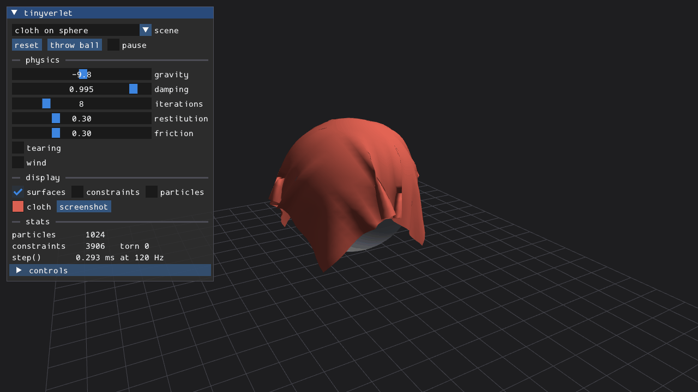
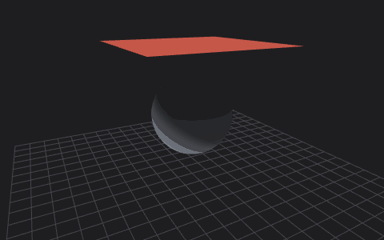
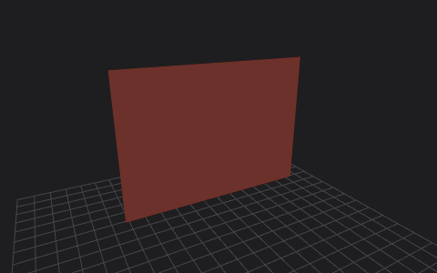
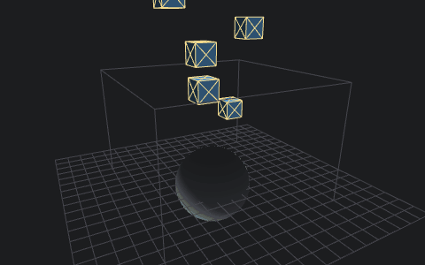

# tinyverlet

[](https://github.com/varnholt/tinyverlet/actions/workflows/ci.yml)

Verlet physics in a single C++23 header: particles, distance constraints, cloth,
ropes, soft boxes, collisions, wind and tearing. Comes with an OpenGL ES 3 testbed
that also runs in the browser (WebGL2 via Emscripten).

**[Live demo](https://varnholt.github.io/tinyverlet/)**: the testbed as WebAssembly, right in your browser.

[](https://varnholt.github.io/tinyverlet/)

- one header, no dependencies: copy `include/tinyverlet/tinyverlet.hpp` into your project
- or use it as a CMake library: `add_subdirectory`, `FetchContent` or `find_package`
- works with your own vector type: anything with `x`, `y`, `z` converts in and out
- deterministic: the same input gives the same result, step for step

## Usage

```cpp
#include <tinyverlet/tinyverlet.hpp>

tinyverlet::World world;
world.settings.ground = 0.0f;
world.spheres.push_back({{0, 1, 0}, 0.6f});

// 32 x 32 cloth, 6.5 cm apart, two metres up
const auto cloth = tinyverlet::add_cloth(world, {-1, 2, -1}, {0.065f, 0, 0}, {0, 0, 0.065f}, 32, 32);

for (int i = 0; i < 240; ++i)
{
   world.step(1.0f / 120.0f);
}

const auto triangles = cloth.triangles(world);  // for rendering; torn cells are left out
```

Bring your own vectors, e.g. glm:

```cpp
world.add_particle(glm::vec3{0, 3, 0});
glm::vec3 p = world.particles[0].position;
```

### API

| | |
|---|---|
| `World::step(dt)` | integrate, then `settings.iterations` rounds of constraints and collisions; returns how many constraints tore |
| `World::add_particle(position, inverse_mass = 1)` | inverse mass 0 pins the particle |
| `World::add_constraint(a, b, stiffness = 1)` | keeps the current distance; stiffness in (0, 1] |
| `World::add_force(particle, force)` | applied during the next step |
| `World::particles`, `constraints`, `spheres` | plain vectors, read and change them freely |
| `add_cloth(world, origin, u, v, columns, rows, options)` | grid with structural, optional shear and bend constraints; returns a `Grid` |
| `Grid::triangles(world)` | surface of the intact cells |
| `add_rope(world, from, to, segments)` | chain of particles |
| `add_box(world, center, size, stiffness)` | 8 corners connected pairwise; soft for low stiffness |
| `add_wind(world, triangles, wind)` | pushes a surface along its normals; `wind` is the acceleration of a sheet facing it |

`Settings` holds gravity, damping, iterations, restitution, friction, the tear ratio,
an optional ground plane and an optional bounding box. Invalid input (missing
particles, bad stiffness or mass) throws `std::invalid_argument`.

Particles only collide with spheres, the ground and the box, not with each other,
so folds of the same cloth can pass through one another.

### How it works

Each step moves every free particle by position Verlet,

```
x' = x + (x - x_prev) * damping + (gravity + force * inverse_mass) * dt^2
```

then repeatedly moves each constrained pair back towards its rest length (split by
inverse mass) and pushes particles out of spheres, the ground and the box. On a
contact, the previous position is rewritten so the particle bounces by
`restitution` and loses `friction` of its sliding speed. With tearing on,
constraints stretched beyond `tear_ratio` times their rest length are removed.

## Testbed

| | |
|---|---|
|  |  |
|  |  |

Five scenes: cloth on a sphere, a gathered curtain in gusty wind, a tearable cloth,
ropes carrying boxes, and rigid to squishy boxes. A Dear ImGui panel changes every
setting live and shows particle and constraint counts and the step time.
Drag a particle to pull it (and tear the cloth), drag elsewhere to orbit, scroll to
zoom; B throws a ball at whatever you look at, Space pauses, R resets, Tab switches
the scene.

```sh
cmake -S . -B build -DTINYVERLET_BUILD_TESTBED=ON
cmake --build build
./build/testbed/tinyverlet_testbed
./build/testbed/tinyverlet_testbed --scene "soft boxes" --time 3 --screenshot boxes.png [--ui]
```

The GIFs above are recorded the same way, frame by frame, and assembled with Pillow:

```sh
./build/testbed/tinyverlet_testbed --scene "tearable cloth" --size 480x300 \
    --record frames --frames 72 --fps 24 --throw 0.5
python tools/make_gif.py frames tearable_cloth.gif --fps 24
```

The simulation runs at a fixed 120 Hz whatever the frame rate, so screenshots are
reproducible. The testbed uses only OpenGL ES 3.0, which is what WebGL2 provides,
so the same code runs natively (GLFW + glad) and in the browser:

```sh
emcmake cmake -S . -B build-web -DTINYVERLET_BUILD_TESTBED=ON
cmake --build build-web
python -m http.server -d build-web/testbed   # open http://localhost:8000/tinyverlet_testbed.html
```

On Linux the native build needs the GLFW dependencies, e.g.
`sudo apt install xorg-dev libwayland-dev libxkbcommon-dev wayland-protocols libgles-dev`.

## Integration

Needs C++23 (GCC 14, Clang 19, MSVC 19.38 or newer; CI covers all three and Emscripten).

### Single header

Copy `include/tinyverlet/tinyverlet.hpp`, then `#include "tinyverlet.hpp"`.

### CMake FetchContent

```cmake
include(FetchContent)
FetchContent_Declare(tinyverlet GIT_REPOSITORY https://github.com/varnholt/tinyverlet.git GIT_TAG master)
FetchContent_MakeAvailable(tinyverlet)

target_link_libraries(my_app PRIVATE tinyverlet::tinyverlet)
```

### Installed package

```sh
cmake -S . -B build
cmake --install build --prefix /some/prefix
```

```cmake
find_package(tinyverlet 1 REQUIRED)
target_link_libraries(my_app PRIVATE tinyverlet::tinyverlet)
```

Tests build only when tinyverlet is the top-level project; the testbed only with
`TINYVERLET_BUILD_TESTBED=ON`. Override with `TINYVERLET_BUILD_TESTS` and `TINYVERLET_INSTALL`.

## License

[GPL-3.0](LICENSE). The testbed uses [GLFW](https://www.glfw.org) (zlib),
[Dear ImGui](https://github.com/ocornut/imgui) (MIT), a [glad](https://github.com/Dav1dde/glad)
generated loader and [stb_image_write](https://github.com/nothings/stb) (public domain / MIT).
